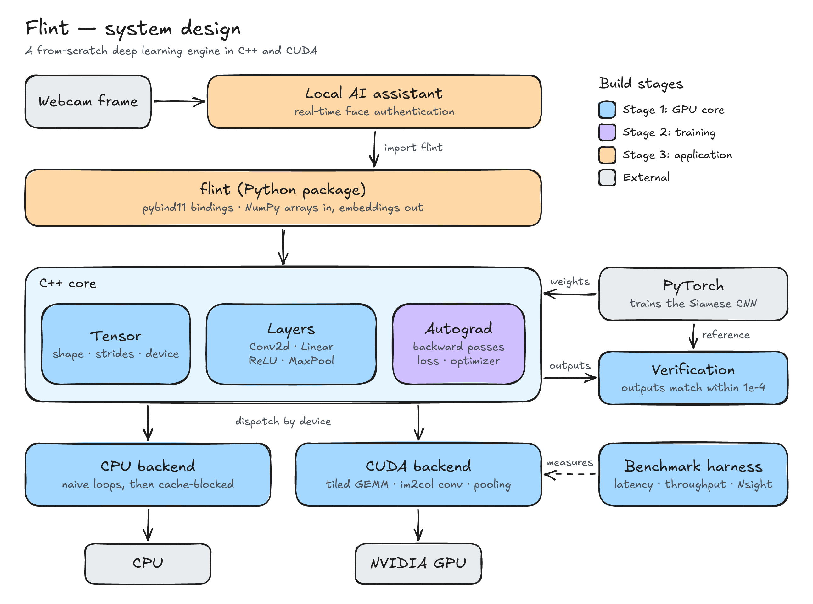

# Flint

A deep learning engine written from scratch in C++ and CUDA. Flint implements the parts PyTorch normally hides: the tensor math, the GPU kernels, and backpropagation.

> **Status: design phase.** No engine code has landed yet. This README describes the design and the build order. Results are added as each stage is built and measured.



## Why

Flint exists to answer one question by building the answer: what actually happens between a line of Python and the GPU?

The test case is a Siamese CNN for face recognition, taken from a local AI assistant. It is small enough to implement end to end and real enough that the results matter. Every operation is written by hand, checked against PyTorch on the same input, and then timed.

## How it fits together

| Part | What it does |
| --- | --- |
| **Local AI assistant** | Sends webcam frames for face authentication. The engine's first real user. |
| **`flint` Python package** | pybind11 bindings. NumPy arrays go in, embeddings come out. |
| **C++ core** | `Tensor` (shape, strides, device), layers (Conv2d, Linear, ReLU, MaxPool), and autograd (backward passes, loss, optimizer). |
| **CPU backend** | Plain loops first, then a cache-blocked version. The baseline everything else is measured against. |
| **CUDA backend** | Hand-written kernels: tiled GEMM, im2col convolution, pooling. |
| **Verification** | Runs the same input through Flint and PyTorch. Outputs must match within 1e-4. |
| **Benchmark harness** | Times every backend across batch sizes. Nsight profiles the GPU kernels. |

## Roadmap

Three stages. Each one ends with something that can be measured.

### Stage 1: GPU core

- [ ] Tensor class and a CPU forward pass (convolution, matrix multiply, ReLU, pooling)
- [ ] Load weights exported from PyTorch, with outputs matching within 1e-4
- [ ] Cache-aware CPU matrix multiply (loop reordering, blocking)
- [ ] First CUDA kernels: naive GEMM and convolution
- [ ] Optimized kernels: shared-memory tiling, im2col + GEMM, batching
- [ ] Benchmark suite: every backend against PyTorch, by batch size

### Stage 2: Training

- [ ] Backward pass for every layer
- [ ] Loss function and optimizer
- [ ] Train the Siamese CNN on Flint and compare its accuracy with the PyTorch-trained model
- [ ] FP16 inference: accuracy against speed and memory

### Stage 3: Application

- [ ] pybind11 bindings built with CMake (`import flint`)
- [ ] Flint as the assistant's face-authentication backend, with end-to-end latency measured

## Benchmarks

None yet. Numbers will be published here as each backend is measured, together with the hardware they were measured on and an analysis of where the remaining gap to cuDNN comes from.

## How this repo is built

Flint is a learning project, so one rule comes first: I write every line of the engine myself. AI tools act as tutor and reviewer, not author. The working agreement is in [`CLAUDE.md`](CLAUDE.md).

Work is spec-first. Requirements and acceptance criteria are written before any code, and each shipped feature gets a short page in [`docs/design/`](docs/design/) explaining what was built, why, and what was ruled out.

## Repository layout

```text
README.md                        this file
CLAUDE.md                        project brain: rules, architecture, commands
.cursor/rules/project.mdc        points Cursor at CLAUDE.md
docs/system-design.png           the diagram above
docs/system-design.excalidraw    its editable source (open at excalidraw.com)
docs/design/                     one page per shipped feature
```

Source directories appear as Stage 1 lands.

## References

- [CUDA C++ Programming Guide](https://docs.nvidia.com/cuda/cuda-c-programming-guide/)
- [PyTorch documentation](https://pytorch.org/docs/stable/)
- [pybind11 documentation](https://pybind11.readthedocs.io/)
